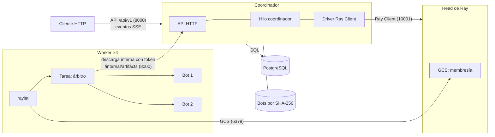

# Arquitectura

El sistema ejecuta torneos de bots de Nim. Un **coordinador** guarda todo el
estado en PostgreSQL, decide qué partida se juega y dónde, y acepta los
resultados. Los **workers** juegan las partidas. **Ray** solo transporta cada
intento al worker elegido y avisa si muere. El mismo diseño corre en
contenedores Docker o como procesos en Linux/WSL.

## Roles, procesos y canales

- **Cliente:** registra bots, crea y cancela torneos y sigue sus eventos.
- **Coordinador** (un solo proceso):
  - la API HTTP (FastAPI) con las rutas públicas y la descarga interna de bots;
  - el hilo coordinador: turnos entre torneos, límite de intentos simultáneos,
    plazos, reintentos y aceptación de resultados;
  - el driver de Ray Client, que envía cada intento al worker elegido.
- **PostgreSQL:** la única fuente de verdad.
- **Head de Ray:** el GCS (quién está vivo) y el servidor de Ray Client.
- **Worker:** su raylet recibe la tarea; el árbitro descarga los dos bots,
  verifica su SHA-256, los lanza como procesos con límites y juega la partida.
  Un worker juega una partida a la vez.

Sin Docker (`deploy/local/`), cada rol es un proceso de WSL con los mismos
puertos y la misma configuración.

## Quién posee cada estado

- **PostgreSQL** (durable): bots registrados, torneos, partidas, intentos con su
  generación, resultados aceptados, historial de eventos y claves de
  idempotencia. Todo lo que el cliente puede consultar sale de aquí.
- **Volumen de artefactos del coordinador** (durable): los bytes de cada bot,
  por su SHA-256. Solo el coordinador escribe; los workers lo leen por la
  descarga interna.
- **Memoria del coordinador** (se pierde al reiniciar y se reconstruye desde
  PostgreSQL): intentos en vuelo, turnos, esperas entre reintentos y sospechas
  sobre workers.
- **GCS de Ray** (efímero): qué nodos están vivos. El coordinador lo traduce a su
  propia membresía (`available`, `suspected`, `lost`).
- **Worker:** nada durable; descarga los bots en cada intento.

## Qué se pierde con cada nodo

- **Un worker:** sus partidas en curso. Si muere con la partida en marcha, Ray
  avisa en menos de un segundo; si queda aislado, actúa el plazo del intento
  (90 s). La partida se
  repite en otro worker; no se pierde nada confirmado.
- **El head de Ray:** toda la ejecución se para. `/ready` pasa a 503 a los
  ~45 s y no se acepta nada. Después los torneos terminan. No se pierde nada
  confirmado.
- **El coordinador:** la API y la ejecución se paran. Al arrancar, los intentos
  en curso quedan perdidos (`attempt.lost`) y se repiten; lo aceptado se
  conserva y el cliente reanuda sus eventos.
- **PostgreSQL:** se para todo (`/ready` 503). Su durabilidad es la de su
  volumen.
